<p align="center">
  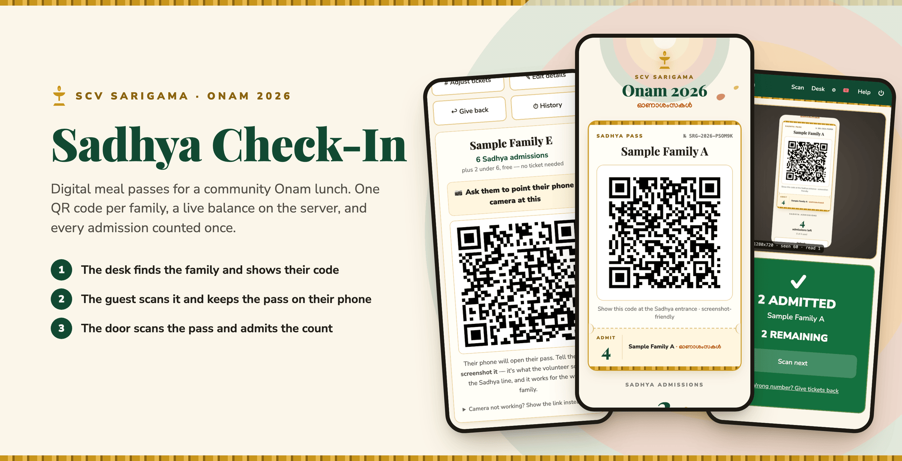
</p>

<p align="center">
  <b>Digital Sadhya passes for SCV Sarigama's Onam 2026 celebration.</b><br>
  Each family gets one QR pass, the balance lives on the server, and the scanner at the food line admits only what is left.
</p>

<p align="center">
  
  
  
  
  
  
  
  
  
  
  
  
</p>

<p align="center">
  <a href="#see-it-work">Demo</a> ·
  <a href="#how-it-works">How it works</a> ·
  <a href="#design-decisions">Design decisions</a> ·
  <a href="#architecture">Architecture</a> ·
  <a href="#run-it">Run it</a> ·
  <a href="#notes-for-whoever-picks-this-up-next">Notes</a> ·
  <a href="#known-limitations">Limitations</a>
</p>

> [!IMPORTANT]
> **Volunteers on event day:** read **[EVENT_DAY.md](./EVENT_DAY.md)** instead of this file. It covers the desk, the scanner, and the admin view, step by step.

> [!NOTE]
> This app was built for one event, the SCV Sarigama Onam 2026 Sadhya, and is deployed at **https://checkin.scvsarigama.com**. Every screenshot in this README comes from the real app running locally against a throwaway database of fake sample households. None of it is real guest data.

## Why

This app replaces paper Sadhya meal tickets with one QR pass per household, carrying any number of admissions. The QR identifies the family and nothing else. The balance lives in Postgres and is checked on every scan. A family can screenshot the code, share it with their kids, and use it at three different times, and it still can't be used more times than they paid for. Grandparents can eat at 1 PM and the kids at 3 PM on the same pass.

**Passes are handed over in person.** A volunteer looks up the name, the QR appears on their screen, and the guest scans it with their own phone to receive it. That handover is what makes the system work for the 40 of 92 households who paid by Zelle and left no contact details. Buyers who did leave an email address also get the same pass by email.

## See it work

<p align="center">
  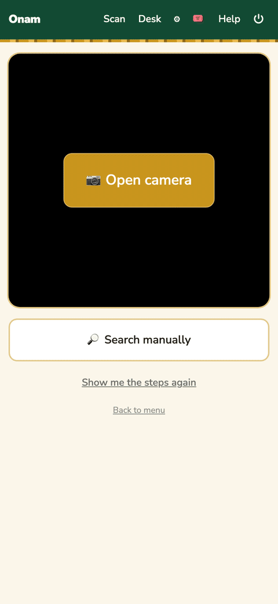
</p>

<sub>Recorded from the real app in headless Chromium against a local database of fake households. The camera feed is simulated: Chromium's fake camera plays a still image of a sample pass, and the app's own QR decoder reads it. Every step after the decode is the real lookup, count, and redemption.</sub>

## How it works

<table>
  <tr>
    <td width="50%">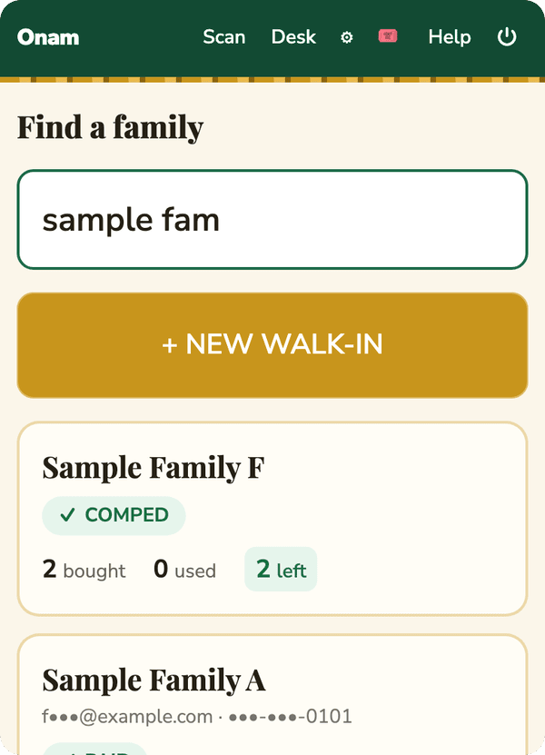</td>
    <td width="50%">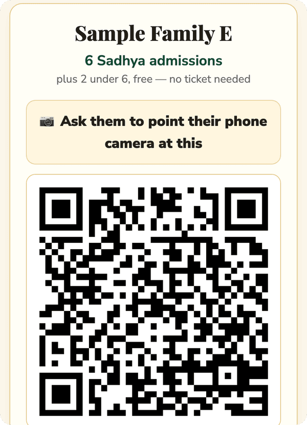</td>
  </tr>
  <tr>
    <td valign="top"><b>1. The desk finds the family.</b> A volunteer types part of a name, email, phone, or order number. Each result shows payment status and how many admissions are left. Walk-ins are added here too, and the volunteer marks one paid only once the money is in hand.</td>
    <td valign="top"><b>2. The guest scans the desk's screen.</b> Their phone opens their own pass, and they keep it. If the phone camera won't cooperate, <i>Camera not working? Show the link instead</i> shows the address to type.</td>
  </tr>
  <tr>
    <td width="50%">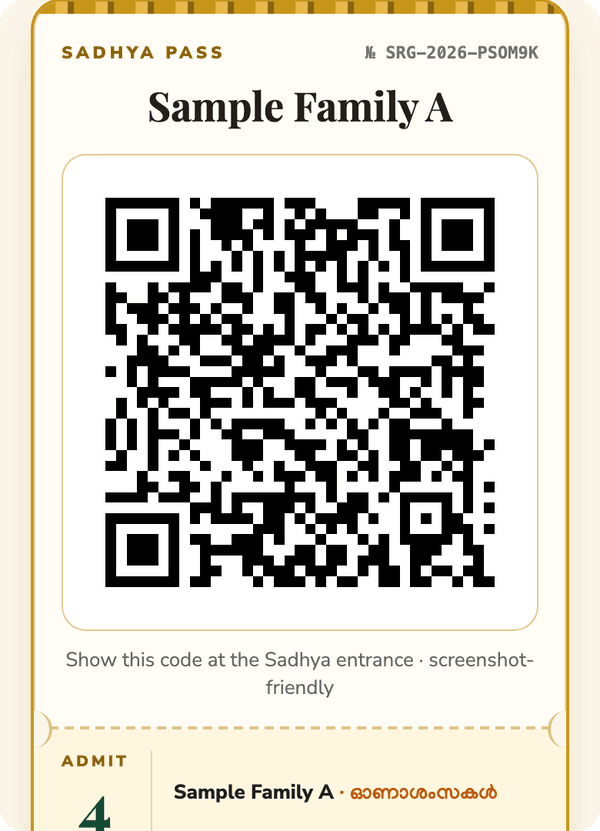</td>
    <td width="50%">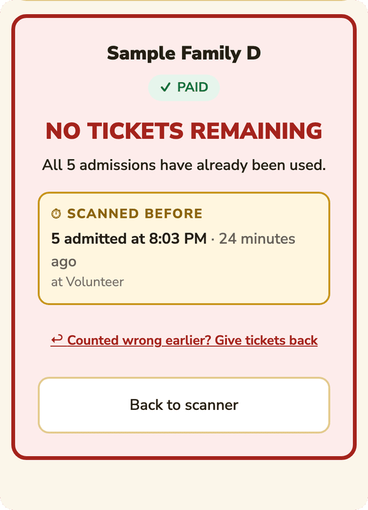</td>
  </tr>
  <tr>
    <td valign="top"><b>3. The pass lives on the guest's phone.</b> The QR holds only the pass link. The page shows the live balance and refreshes itself, so a screenshot taken in the morning still scans correctly in the afternoon.</td>
    <td valign="top"><b>4. The door checks the live balance.</b> The scanner asks how many are eating right now, repeats the under-6 rule on a confirm screen, and admits that many. A pass with nothing left is refused, and the screen shows when it was last scanned.</td>
  </tr>
</table>

### Passes by email

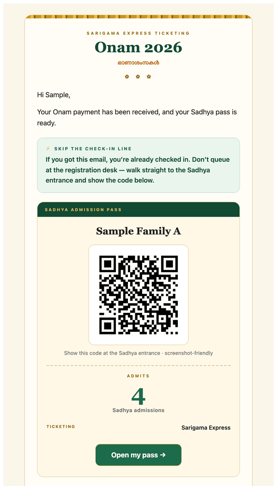

When a Square payment lands, the webhook creates the household and mails the pass automatically. Repeat purchases that share an email address are merged into one pass before mailing, and the pass is re-sent when its admission count changes. The email carries the same QR code as the pass page, so either one works at the door.

`npm run send-passes` is a dry run until you pass `--commit`. While `EMAIL_TEST_REDIRECT` is set, no email can reach a real guest, and `AUTO_SEND_PASSES=off` stops automatic sending without a deploy.

The same pipeline sends a final-details reminder before the event and a thank-you afterwards. Links in the thank-you email go through `/r/{token}/{target}`, which records the click against the household before forwarding.

<br clear="right">

### For organizers

<table>
  <tr>
    <td width="50%">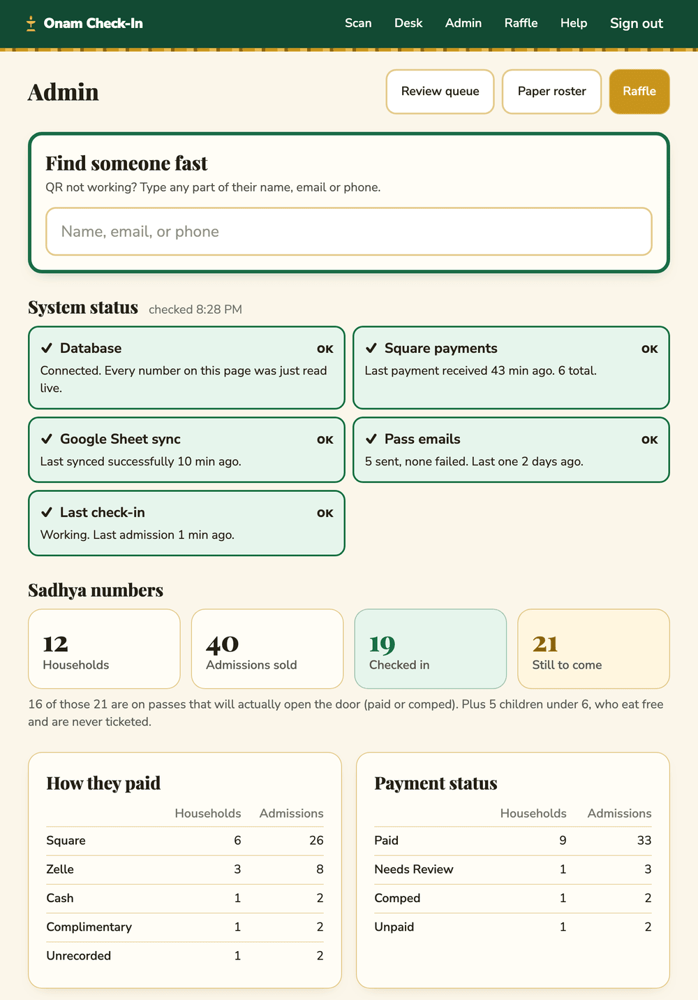</td>
    <td width="50%">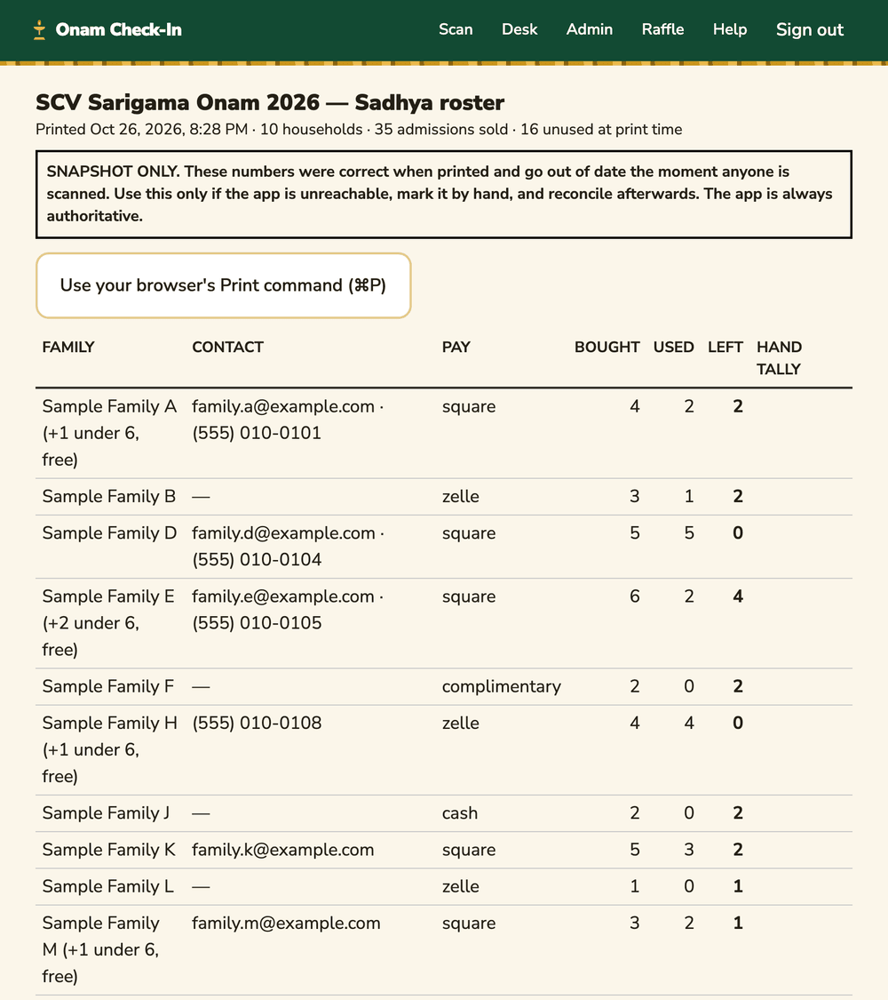</td>
  </tr>
  <tr>
    <td valign="top"><b>Admin dashboard.</b> Emergency lookup at the top, then the health of the database, the Square webhook, the sheet sync, and pass emails. Below that: live counts, the review queue, the latest check-ins, and a CSV export.</td>
    <td valign="top"><b>Paper roster.</b> The fallback if the venue loses signal: every household and its balance at print time, with a column to tally by hand. Print it before the event starts.</td>
  </tr>
</table>

<p align="center">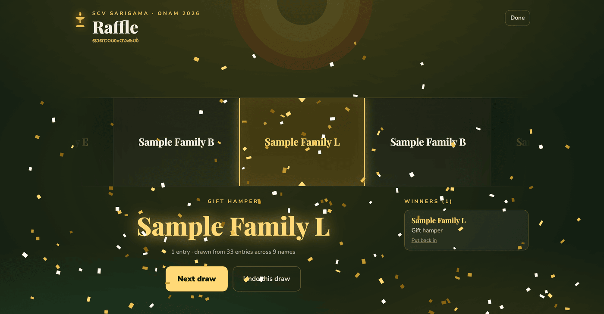</p>

<sub>The end-of-day raffle. Every ticket bought is one entry, whether or not it was used. The database picks the winner before the reel spins, so the animation is only theatre: if the laptop dies mid-spin, the draw is already recorded.</sub>

After the event, `/2026onamanalytics` shows a public report of the day: guests served, turnout, arrivals over time, and how the run sheet kept to schedule. It names guests but shows no contact details, devices, or payment identifiers. The full report, with corrections, syncs, and webhooks, is at `/2026onamanalytics/admin` behind the volunteer password. It isn't pictured here because it only means something with the real event's data.

### iPad scanner

[`ipad/`](ipad/) holds a native SwiftUI build of `/staff/scan` for iPad. It talks to the same server endpoints and follows the same rules: the camera fills the screen, two codes in frame make the volunteer tap the right one, and nothing is redeemed off a single tap. It chimes on decode with sounds synthesized at launch. See [`ipad/README.md`](ipad/README.md) for setup. The iPad app isn't pictured.

## Design decisions

### The three things that must not break

**1. Redemption is atomic.** `redeem_tickets()` puts every precondition in the `WHERE` clause of a single `UPDATE`, so Postgres row locking serializes concurrent scans. Twenty simultaneous attempts to take the last 3 tickets produce exactly one success. The test suite asserts this, and it was re-verified against production. `CHECK (tickets_redeemed <= tickets_purchased)` backs it up independently, so even a direct `UPDATE` can't over-redeem.

**2. Ticket counts are never inferred.**

| Source | Authority | Explicitly NOT used |
|---|---|---|
| Square | `line_item.quantity`, matched by **catalog variation ID** | the dollar amount; the variation's display name |
| Sheet | the `No Of People` column | `Amount Paid` |

The Square display name lies: a real Aug 9 order reads `(Ages 6+ [$25.00]) × 2` and was charged $30, because the price rose mid-sale and the label went stale. The sheet lies differently: rows like `Malabar Gold / $500 / 2` bundle a donation with the tickets. Anything that can't be mapped confidently becomes a `needs_review` row rather than a guess.

**3. Under-6 children never consume an admission.** They're recorded in `children_under_6` for honest headcounts and shown at the desk, but they walk in free with no ticket.

### Other choices

- **The QR encodes the pass URL and nothing else.** No balance, no name, no ID. A stale screenshot resolves to the live balance.
- **Two taps to admit.** The volunteer picks a count, then confirms it on a screen that repeats the under-6 rule. A single mistaken tap redeems nothing.
- **Corrections are records, not edits.** A wrong scan is reversed with a reason, and both the mistake and the correction stay in the history.
- **One shared volunteer password.** Handing out and resetting a dozen logins on event day costs more than it buys. The trade-off: the audit trail says "Volunteer" rather than a person. Sessions last 14 days, and only a SHA-256 hash of each session cookie is stored.
- **Light theme only.** Volunteers use borrowed phones outdoors, so a dark scheme from a device setting would hurt legibility and QR contrast.

## Architecture

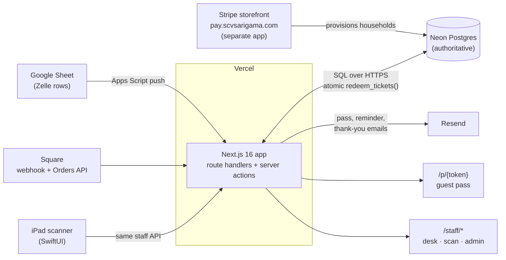

**Everything touching data is server-side.** The browser never holds a database credential, and every read and write goes through a route handler or server action. Scans and lookups use Neon's SQL-over-HTTPS driver, one round trip each. Only the migration and import scripts open a WebSocket, for multi-statement transactions.

The Apps Script in [`apps-script/Code.gs`](apps-script/Code.gs) runs as the sheet's owner. Every few minutes it pushes the payment rows to the app. The same run pulls walk-ins back into the ledger and fills separate tabs with paid storefront orders, contacts, and an event log.

### Routes

| Route | Who | What |
|---|---|---|
| `/p/{token}` | guest, no login | The pass: QR, name, live balance, raffle entries |
| `/staff/scan` | volunteer | Scan, confirm, redeem, optional give-back |
| `/staff/registration` | volunteer | Search, walk-ins, payment, ticket fixes |
| `/staff/admin` | volunteer | Stats, system status, reversals, CSV, emergency lookup |
| `/staff/admin/review` | volunteer | Review queue for rows the importers couldn't map |
| `/staff/admin/roster` | volunteer | Printable paper contingency roster |
| `/staff/help` | volunteer | The desk and scanner instructions |
| `/raffle` | volunteer | End-of-day raffle stage |
| `/2026onamanalytics` | public | After-event report, with personal details left out |
| `/2026onamanalytics/admin` | volunteer | The full after-event report |

### Folders

| Folder | What it holds |
|---|---|
| [`src/app/`](src/app/) | Pages and API routes: pass, staff, raffle, report, webhooks, sync endpoints |
| [`src/lib/`](src/lib/) | Database access, households, scanning, Square and sheet import, email, raffle, analytics |
| [`db/migrations/`](db/migrations/) | SQL migrations, applied in filename order |
| [`scripts/`](scripts/) | Migrate, seed, import, merge, send passes, and other one-off CLIs |
| [`tests/`](tests/) | Vitest suites |
| [`apps-script/`](apps-script/) | The Google Apps Script bound to the payments sheet |
| [`ipad/`](ipad/) | The SwiftUI iPad scanner |

## Run it

You need Node.js, a Postgres database on Neon, and the environment variables listed in the following section.

```bash
npm install
vercel env pull .env.local     # or create .env.local by hand
npm run migrate
npm run seed                   # four demo households
npm run dev
```

The npm scripts read `.env.local`, so migrations, seeds, imports, and tests run against whatever `DATABASE_URL` points at.

`npm run create-staff -- --email you@example.com --name "You" --role admin` creates an individual login. Day to day, volunteers use the shared password in `STAFF_PASSWORD` instead.

### Commands

| Command | Does |
|---|---|
| `npm run dev` | Start the dev server |
| `npm run build` | Production build |
| `npm run lint` | ESLint |
| `npm run migrate` | Apply `db/migrations/*.sql` (idempotent) |
| `npm run seed` | Create demo households · `-- --purge` to remove |
| `npm test` | Full suite, including the concurrency tests |
| `npm run create-staff` | Create or reset an individual staff login |
| `npm run import:sheet` | Sheet import dry run · `-- --csv <file>` to use a local export · `-- --commit` to write |
| `npx dotenv -e .env.local -- npx tsx scripts/import-square.ts` | Square import dry run · `--commit` to write |
| `npx dotenv -e .env.local -- npx tsx scripts/square-catalog.ts` | List catalog variation IDs (read-only) |
| `npm run merge` | Plan folding each person's separate purchases into one pass · `-- --commit` to write |
| `npm run send-passes` | Plan the pass mailing · `-- --limit 3 --commit` to send a few |
| `npm run accept-reviews` | Accept open amount mismatches as paid and lock them · `-- --commit` to write |
| `npm run backfill:square` | Re-ask Square for buyer contacts on unnamed terminal sales · `-- --commit` to write |

Imports are **dry runs by default** and write a preview CSV to `out-import/`. `--commit` writes, in one transaction tagged with an `import_batches` row.

### Environment

`.env.example` is kept locally but isn't committed, because `.gitignore` excludes `.env*`. The app reads these variables:

| Group | Variables |
|---|---|
| Core | `DATABASE_URL`, `APP_BASE_URL`, `STAFF_PASSWORD`, `CRON_SECRET` |
| Square | `SQUARE_ACCESS_TOKEN`, `SQUARE_LOCATION_ID`, `SQUARE_ENVIRONMENT`, `SQUARE_WEBHOOK_SIGNATURE_KEY`, `SQUARE_VARIATION_ADULT`, `SQUARE_VARIATION_UNDER6`, `SQUARE_VARIATION_SPONSOR`, `SQUARE_WEBHOOK_NOTIFICATION_URL` |
| Google Sheets | `GOOGLE_SHEET_ID`, `GOOGLE_SHEET_TAB`, `GOOGLE_SERVICE_ACCOUNT_JSON_B64` |
| Email | `RESEND_API_KEY`, `EMAIL_FROM`, `EMAIL_TEST_REDIRECT`, `AUTO_SEND_PASSES` |
| Event details | `EVENT_DATE_LINE`, `EVENT_VENUE`, `EVENT_ADDRESS`, `EVENT_TIMING`, `EVENT_PARKING`, `EVENT_NOTES`, `THANKYOU_VIDEO_URL`, `FEEDBACK_FORM_URL` |

`DATABASE_URL` comes from the Neon integration, and the rest are set with `vercel env add`. Nothing secret is committed. The event details are optional: a blank value drops the line from the pass and the emails rather than printing a guess.

`out-import/` is gitignored because preview CSVs contain guest contact details.

### Tests

`npm test` runs 122 test cases in 7 Vitest files: atomic and concurrent redemption, scan history, sheet parsing, Square line-item mapping, the raffle, and the pass and thank-you mailings. **The tests hit a real database.** See the first note in the following section.

## Notes for whoever picks this up next

**Tests hit the real database.** They only create and delete rows with `source = 'vitest'`, so they can't touch real guests or the seeded demos. That scoping is deliberate: an earlier version keyed cleanup off `is_test` and quietly deleted the demo households on every run.

**`ws` must stay a lazy import in `src/lib/db.ts`.** Importing it at module scope crashes every database-backed function on Vercel at boot: empty 500, no log, while the identical build serves fine locally. Only the transaction path needs a WebSocket; the query path is SQL over HTTPS.

**Email can't reach a real guest while `EMAIL_TEST_REDIRECT` is set.** The redirect is applied inside the provider factory, not at call sites, so it can't be bypassed by accident. Clearing it is a deliberate, one-time act.

**Google Sheets is an import source, not the ledger.** Nothing during the event depends on it being reachable. If the sheet and the app disagree on event day, the app wins.

**No offline redemption, ever.** Two phones offline at the same entrance would both believe they had the last ticket. The scanner tells the volunteer to stop instead. `/staff/admin/roster` is the paper fallback, so print it beforehand.

## Known limitations

- **Built for one event.** The event name, the `/2026onamanalytics` route, and the run sheet in `src/lib/analytics/program.ts` are specific to Onam 2026.
- **The line can outrun the scanner.** Near the end of the Sadhya, families walked in without being scanned. The report records them as "marked present" after the fact, separately from scanned admissions.
- **Terminal sales arrive without a name.** A card-present Square sale carries no buyer name, so the household starts as `Square order <id>` until someone fixes it at the desk. `npm run backfill:square` recovers an email or phone where the buyer gave one.
- **Anyone with the volunteer password can redeem,** and the audit trail can't tell volunteers apart.
- **The tests need a live database.** There is no local or in-memory test database.
- **The iPad app is sideloaded.** A free Apple ID signs the build for 7 days; a paid developer account signs it for a year.

## Credits

Built by Noel Sason for SCV Sarigama's Onam 2026 celebration. The Stripe storefront at pay.scvsarigama.com and the point-of-sale tables in `0013_pos.sql` belong to separate projects that share this database.
